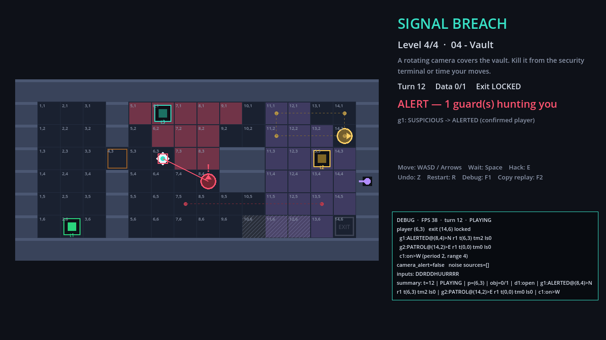
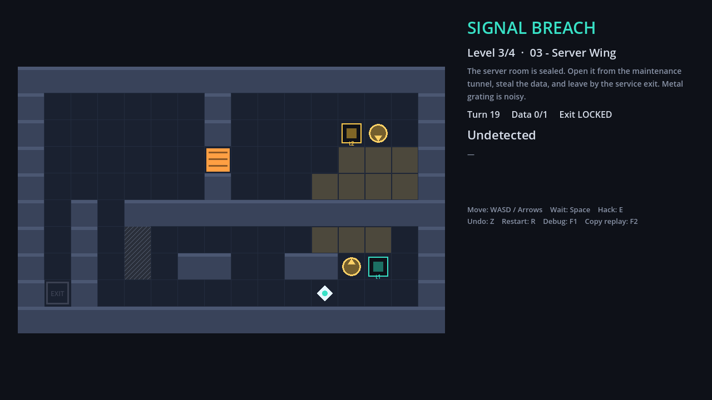

# Signal Breach

**Turn-based grid stealth & hacking puzzle — Godot 4.3+ · GDScript · playable in the browser**

Sneak through a facility, hack the data terminals and reach the exit without being caught. Guards patrol with vision cones, react to noise and chase you once alerted. Cameras rotate on a timer and can be shut down from a terminal. Every turn can be undone.





> **Play:** _itch.io link here_ · **Controls:** WASD / arrows move · Space wait · E hack · Z undo · R restart · F1 debug overlay · F2 copy input log

---

## Why this project exists

This is a deliberately small game built to show **systems that interact** and **state you can verify**:

- A deterministic simulation: the same level plus the same input string always produces the same final state.
- Several systems that interact each turn (player commands, environment, sensors, guard AI) in a fixed, tested order.
- Undo built on snapshots of state, with tests that catch the subtle "half-restored state" bugs.
- QA tooling built in: a debug overlay, a replayable input log, a solver that proves each level can be beaten, and a headless test suite running in CI.
- A [`tasks/`](tasks/) folder of bug-fix and feature challenges, each with a brief, a reference solution and acceptance criteria.

## Architecture overview

```
scripts/
  core/          Pure simulation: no nodes, no randomness, no frame time
    game_state.gd      Complete state of a level + deep clone() + summary()
    level_grid.gd      Immutable layout, shared between snapshots
    turn_processor.gd  Turn pipeline + undo history (Command + Memento)
    level_loader.gd    JSON -> GameState, plus level validation
    replay.gd          Runs an input string ("RRDHZW") headless
  commands/      Player actions (Command pattern): Move, Wait, Interact
  ai/            GuardBrain: guard state machine (stateless; data lives in GuardData)
  systems/       Vision (cone + Bresenham LOS), NoiseSystem (flood fill), Pathfinding (BFS)
  presentation/  Godot nodes: drawing, HUD, debug overlay, input mapping
levels/          JSON levels with a stored reference_solution
tests/           Headless test runner + 37 unit/integration tests
tools/           solve.gd (A* solvability), trace.gd (turn-by-turn log), capture.gd (screenshots)
tasks/           Bug & feature challenges with briefs, solutions, acceptance criteria
```

**Rule:** dependencies only point inward. `presentation` reads `core`, but `core` never touches a Node. That is why the full ruleset can be tested without opening a window.

### Turn pipeline (`TurnProcessor`)

| # | Phase | What happens |
|---|-------|--------------|
| 0 | Validate | An invalid command (walking into a wall, hacking with no terminal next to you) is rejected. **No turn is consumed and no snapshot is taken.** |
| 1 | Snapshot | `state.clone()` is pushed onto the undo stack. |
| 2 | Player | The command runs and the turn counter goes up by 1. Stepping on a noisy tile queues a noise event. |
| 3 | Victory | Standing on the exit with every objective hacked → `WON`. The turn ends here, so guards never get to react. |
| 4 | Environment | Cameras rotate when `turn % period == 0`. |
| 5 | Sensors | An enabled camera that sees the player raises an alarm at the player's position. |
| 6 | Perception | **Every** guard perceives the same world (vision, noise, alarm) before any guard moves. |
| 7 | Guards | Guards act in list order. One step each. A catch ends the turn. |

### Guard state machine (`GuardBrain`)

```
PATROL ──sees player (> 2 tiles) / hears noise──▶ SUSPICIOUS
PATROL ──sees player (≤ 2 tiles) / camera alarm──▶ ALERTED
SUSPICIOUS ──sees player / camera alarm──▶ ALERTED
SUSPICIOUS ──reaches target, looks around 2 turns──▶ PATROL
ALERTED ──no line of sight for 3 turns──▶ SUSPICIOUS (at last known position)
ALERTED + orthogonally adjacent ──▶ player CAUGHT
```

### Systems interaction examples

- **Terminal → Door → Vision → Noise:** hacking `t1` opens `d1`. An open door no longer blocks line of sight or sound, so a guard in the next room can now see and hear you.
- **Terminal → Camera → Guards:** hacking `t3` disables `c1`. That removes a sensor which would otherwise put every guard in ALERTED with the same target.
- **Noise → Guard AI → Pathfinding:** a noisy tile pulls a guard off its route. It walks there by BFS, searches, then pathfinds back to its patrol.

## Known edge cases handled

| Edge case | Where | Test |
|-----------|-------|------|
| Vision through diagonal wall corners is blocked (Archives shelves) | `Vision.has_line_of_sight` | `test_diagonal_corner_gap_blocks_sight`, `test_shelf_corner_hides_player_in_level_02` |
| Cameras are mounted on walls, so the viewer's own tile never blocks sight | `Vision.has_line_of_sight` | `test_viewer_inside_wall_can_see_out` |
| Noise travels around corners but not through walls or closed doors | `NoiseSystem.propagate` | `test_noise_does_not_pass_through_walls`, `test_noise_blocked_by_closed_door` |
| Rejected input never takes up a turn or an undo slot | `TurnProcessor.submit` | `test_invalid_move_consumes_no_turn`, `test_rejected_command_is_not_undoable` |
| Undo restores the guard's *memory* (target, search timer), not only its position | `GuardData.clone` | `test_undo_restores_guard_memory`, `test_undo_redo_matches_straight_run_on_level_01` |
| Snapshots never share arrays or dictionaries | `GameState.clone` | `test_snapshots_are_independent` |
| Undo still works after being caught | `TurnProcessor.undo` | `test_undo_after_being_caught` |
| The player escapes a cone before guards look (player acts first) | turn pipeline | `test_player_acts_before_guards_perceive` |
| Simultaneous perception: guard order cannot change what each guard sees | turn pipeline | — |
| Guards never walk into each other or onto the player; they turn to face the blocker instead | `GuardBrain._step_toward` | — |
| Tie-breaks are deterministic (fixed neighbour order N, E, S, W) | `Dir.ORDER` | `test_replay_is_deterministic` |
| `.json` levels are not Godot resources, so they must be force-included in the Web export | `export_presets.cfg` (`include_filter`) | — |
| Web build runs without SharedArrayBuffer (itch.io friendly) | `variant/thread_support=false` | — |

## Running it

```bash
# Tests (headless, exit code 1 on failure)
godot --headless --path . --import
godot --headless --path . --script res://tests/run_tests.gd

# Prove each level is solvable and print a short solution
godot --headless --path . --script res://tools/solve.gd -- res://levels/level_01.json

# Turn-by-turn trace of an input sequence (Z = undo), with ASCII boards
godot --headless --path . --script res://tools/trace.gd -- res://levels/level_01.json DDDRRWWWWWWWRW --board
```

**Input tokens:** `U D L R` move · `W` wait · `H` hack · `Z` undo. Press **F2** in-game to copy the current input log, so any bug report can be reproduced exactly.

### Web export (itch.io)

1. In Godot: *Editor → Manage Export Templates → Download* (same version as the editor).
2. *Project → Export → Web → Export Project* → `build/web/index.html`.
3. Zip the contents of `build/web/` and upload it to itch.io as an HTML game (viewport 1280×720, "SharedArrayBuffer support" **off**).

## Level format

```json
{
  "name": "03 - Server Wing",
  "map": ["#P..D..#", "..."],
  "doors":     [{ "id": "d1", "pos": [7, 3] }],
  "terminals": [{ "id": "t1", "pos": [13, 7], "objective": false, "targets": ["d1"] }],
  "guards":    [{ "id": "g1", "pos": [12, 6], "facing": "W", "route": [[9, 6], [9, 8]] }],
  "cameras":   [{ "id": "c1", "pos": [15, 4], "facings": ["W", "N"], "period": 2, "range": 4 }],
  "reference_solution": "DRRDD..."
}
```

Map legend: `#` wall · `.` floor · `~` noisy floor · `P` player · `E` exit (`D` and `T` are visual hints only). `LevelLoader.validate()` rejects levels with objects inside walls, unknown terminal targets, blocked waypoints and similar mistakes. CI runs it on every level.

## License

MIT
